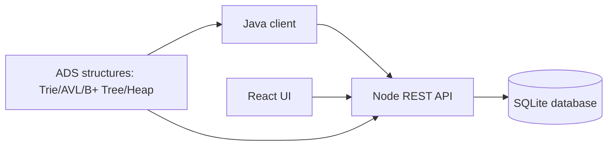

# Architecture

The Java client and the React UI both talk to the same backend API. The API reads and writes demonstration data in SQLite. The ADS structures are used to explain and demonstrate crop lookup and ranking logic without adding a full production infrastructure.
